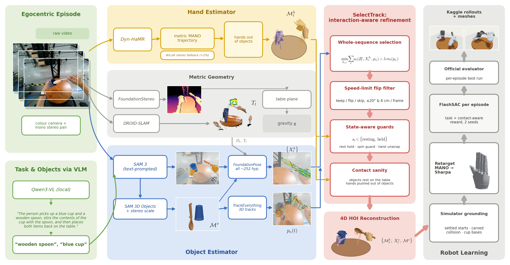
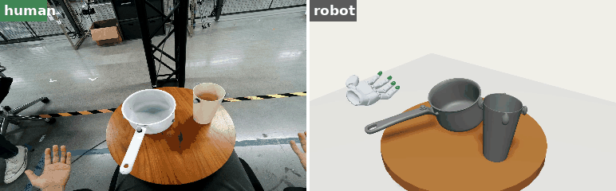
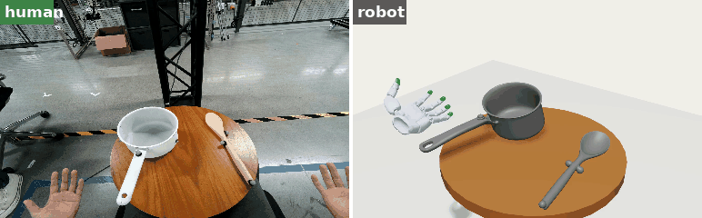
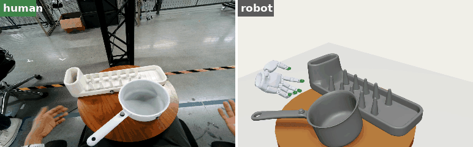
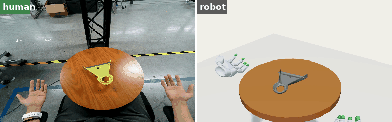
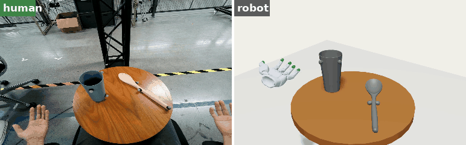
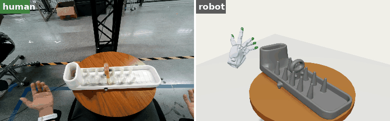
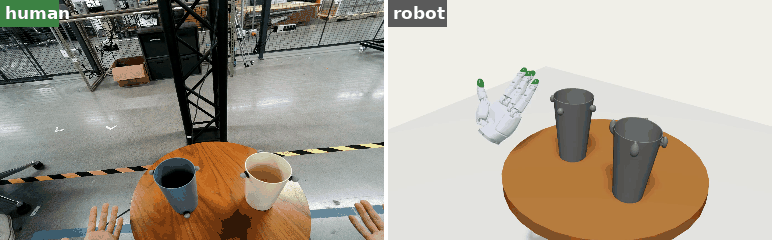
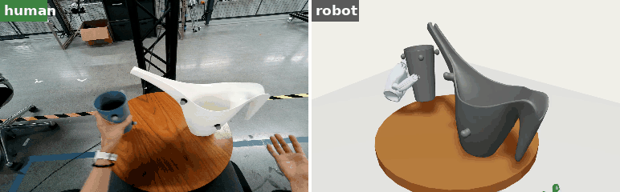

# 🥽➡️🤖 VIPO: Video In Policy Out

From any egocentric video to a dexterous robot policy.

Our **V2D Challenge 2026, Track 3** entry. We take one head-mounted video of a person handling kitchen objects and
turn it into a **Sharpa-hand policy** that re-enacts the task in FlashCHORD. We do not use organiser scans or mocap:
the meshes, poses and hands all come from the video.




**How it works:**
- 🎥 **Perceive:** stereo depth (FoundationStereo) and camera motion (DROID-SLAM). Qwen3-VL names the objects, SAM 3
  segments them, SAM 3D Objects builds the meshes and Dyn-HaMR recovers the MANO hands.
- 🎯 **SelectTrack:** we keep *every* FoundationPose candidate (~252 per frame) plus TrackEverything point tracks, then
  pick the whole trajectory at once. Five layers do this:
  - L1: Viterbi selection over the whole sequence
  - L2: a speed-limit filter that rejects pose flips
  - L3: state-aware guards (rest hold, spin guard, twist unwrap)
  - L4: contact sanity checks
  - L5: simulator grounding
- 🦾 **Learn:** retarget MANO to Sharpa, then train one FlashSAC policy per episode with a contact-aware reward.

Full system description: [`docs/SYSTEM.md`](docs/SYSTEM.md).

## 🎬 Results: human (left) vs. our robot policy (right)

### ✅ Successes

| 🍲 e08 · pour cup into pot | 🥄 e05 · stir pot with spoon |
|:---:|:---:|
|  |  |
| 🍽️ **e28 · put pot in dish rack** | 🧹 **e38 · dust pan pick & place** |
|  |  |
| ☕ **e33 · stir cup with spoon** | 🧽 **e30 · sweeper along rack** |
|  |  |

### ❌ Failures

| 🥤 e10 · stack two cups | 🫗 e20 · pour from pitcher |
|:---:|:---:|
|  |  |
| The reconstructed cup orientation is wrong, so the second cup tips over. | The pitcher is never lifted. |

📊 **Best Kaggle submission (best3):**

| AUC | SP-SR | MP-SR | RPE | MPPE | CD-O |
|:---:|:---:|:---:|:---:|:---:|:---:|
| 0.584 | 0.65 | 0.20 | 7.35 cm | 6.06 cm | 0.401 cm |

## 🚀 How to run

Everything runs as Slurm jobs on an L40S cluster. The heavy stages run inside Apptainer images converted from the
organiser Dockerfiles (see `defs/` and `build_*_sif.sbatch`).

```bash
source env.sh                                    # paths: V2D_ROOT, images, weights
sbatch download_weights.sbatch && bash download_sam3d_weights.sh

# 1️⃣ Perception (per episode in $V2D_ROOT/runs/<run>)
python stages/s01_calibration.py && python stages/s02_prepare_inputs.py   # calibration fix-up, run dirs
sbatch --array=0-39 run_stereo_depth.sbatch               # FoundationStereo depth
sbatch pipelines/t3/vlm_names.sbatch                      # Qwen3-VL task + object names -> SAM 3 prompts
sbatch run_objects_v2.sbatch <run> --segmenter sam3       # masks + SAM 3D meshes
sbatch run_recon.sbatch <run> dynhamr                     # SLAM + MANO hands

# 2️⃣ SelectTrack: object poses
sbatch pipelines/t3/fph_arr.sbatch     # all FoundationPose candidates
sbatch pipelines/t3/te_arr.sbatch      # TrackEverything 3D tracks
sbatch pipelines/t3/tp_arr.sbatch      # Viterbi selection + pose filters
sbatch pipelines/t3/twist.sbatch && sbatch pipelines/t3/rest_table.sbatch && sbatch pipelines/t3/depen.sbatch

# 3️⃣ Robot learning: retarget -> sim assets -> FlashSAC -> official eval
bash robot/cmds/submit_c3.sh runs.txt

# 4️⃣ Pack the submission (per-episode best run)
sbatch pipelines/t3/pack_best.sbatch <out_dir> <commit_url> pipelines/t3/best3_selection.txt

# 🎞️ Rollout videos
LIST=list.txt CAM=front34 sbatch robot/run_fc.sbatch $PWD/robot/cmds/video_pretty.sh
```

Step-by-step pose pipeline: [`pipelines/t3/README.md`](pipelines/t3/README.md).
