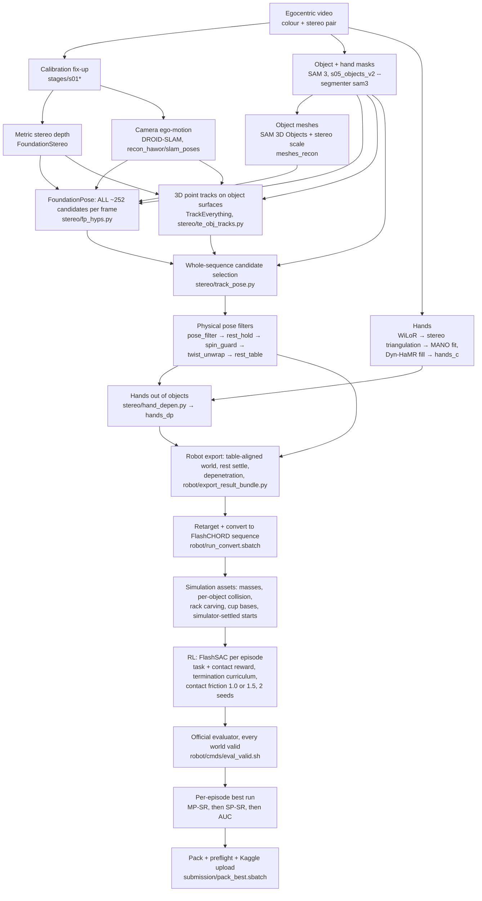

# V2D Challenge 2026 — Track 3 (egocentric video → robot): system description

Team `Kiarash_Ghasemzadeh8` · code `github.com/KiaRational/v2d-track3` · compute: Vulcan (Alliance / Amii), NVIDIA L40S.
Status as of 2026-11-03: best submission **best3** — AUC 0.584, SP-SR 0.650, MP-SR 0.150, RPE 7.35 cm, MPPE 6.06 cm,
CD-O 0.401 cm (~12th of 37 teams on summed metric rank).

## 1. Task

Input per episode: a head-mounted egocentric recording of a person manipulating 1–2 rigid kitchen objects on a round
table (colour camera 2028×1520 at 20.25 fps + a mono stereo pair 1280×800, 75 mm baseline, calibrated intrinsics).
Output per scored episode (20 evaluation episodes):

1. **Object trajectories produced by a robot policy in simulation** (FlashCHORD, floating Sharpa Wave hands), i.e. the
   robot must physically re-enact the human manipulation; the rollout's object poses are scored against hidden
   ground-truth object trajectories (AUC of ADD, SP-SR, MP-SR, RPE, MPPE).
2. **Reconstructed object meshes** (scored by CD-O, Chamfer after Sim(3) registration; Kaggle also uses them to register
   the body frames of all pose metrics).

Final rank = sum of the per-metric ranks. Rules that shaped the design (organiser FAQ): teams must submit their **own
reconstructed meshes** (the public scans may not be used for evaluation objects); method otherwise unconstrained;
pretrained models / external data allowed; a git commit per submission; winners release code (Apache-2.0).

**Data policy we follow:** nothing in the submission pipeline reads the organiser scans or the public mocap. Public-split
mocap is used only for offline development metrics (`beat1/bench_pose.py`, labelled DEV ONLY).

## 2. Architecture

Everything runs as Slurm jobs; heavy stages run in Apptainer images converted from the organiser Dockerfiles
(`bin/docker` shim): `agile`, `v2d_foundation_pose`, `trackeverything`, `flash_chord`, `rg`.

## 3. Stages

### 3.1 Calibration, depth, ego-motion
* **Calibration** (`stages/s01*`): the published `ego_cam_a → stereo-left` extrinsic is actually `a → ego_cam_b`
  (pre-relabel left camera); corrected to 3.4 px reprojection error (18.9 px as published).
  `calib/ego_calib_resolved.json`.
* **Depth**: FoundationStereo on the stereo pair, reprojected into the colour camera (`depth_stereo/`). Metric scale
  for everything downstream.
* **Ego-motion**: DROID-SLAM camera poses (`recon_hawor/slam_poses`), metric via stereo.
* **Table**: RANSAC plane + fixed-radius disk fit from stereo (`stereo/table_plane.py`, r = 0.2375 m; gravity = table
  normal).

### 3.2 Segmentation and meshes
* **Masks**: SAM 3 video segmentation of each object and both hands (`objects_recon/masks/<id>/`; hands are ids 2, 3).
* **Meshes** (`meshes_recon/<obj>/`): SAM 3D Objects from automatically picked unoccluded views of the evaluation videos;
  metric scale from stereo depth; several candidates per object, the consensus (minimum median Sim(3)-registered
  Chamfer to the others) is kept (`stages/objects_v2/{pick_views,select_mesh,render_scale,stereo_scale}.py`).
  Wooden spoon (no public scan at all) built the same way. Data-driven corrections, each scripted with provenance:
  * water pitcher stretched 27.4 → 31.0 cm at its base: the resting pitcher floated 36 mm above the table in all three
    pitcher episodes with a consistent up-axis (`stereo/extend_mesh.py`; earlier ×1.2 uniform scale);
  * dust pan thinned ×0.30 along its thin axis: top surface vs stereo depth 17.3 → 2.3 mm mean error
    (`pipelines/t3/mesh_fit.py`, `dustpan_thin.sbatch`).

### 3.3 Hands
WiLoR keypoints in both stereo views → triangulation with Viterbi handedness and stereo/colour time-sync → MANO
sequence fit (~6 mm MPJPE to triangulation); undetected frames filled from Dyn-HaMR → `stereo/hands_c` (MANO params +
joints per frame, camera frame). Reference fingers were found 2–4 cm *inside* cups in most cup episodes, which makes the
simulator shove hand and object apart at reset; `stereo/hand_depen.py` translates the whole hand (time-smoothed) out of
each object (cups treated as solids) → `stereo/hands_dp`.

### 3.4 Object poses (the core of the system)
1. **All FoundationPose candidates** (`stereo/fp_hyps.py`): per frame, FoundationPose registration from scratch keeps
   every refined hypothesis (~252) with its ScoreNet score instead of only the argmax.
2. **3D point tracks** (`stereo/te_obj_tracks.py`): TrackEverything on our stereo depth / K / SLAM poses; queries seeded
   every 5 frames on SAM 3 object masks minus (dilated) hand pixels and depth edges; tracks in the SLAM world.
3. **Selection over the whole sequence** (`stereo/track_pose.py`), Viterbi over candidates with
   * unary = 1 − score × silhouette IoU (hand pixels excluded) + tracked points' distance to the candidate surface,
   * pairwise = how well the candidate motion X_j X_i⁻¹ reproduces the tracked points' motion (+ weak smoothness,
     symmetry-aware), then a long-range refinement that anchors every track in the object frame (points seen at frame
     50 and at 200 must land on the same mesh spot).
4. **Physical filters** (each a separate step, outputs `*_recon` variants):
   * `pose_filter.py` — symmetry unwrap; Viterbi keep / flip (3 principal axes through the centroid) / skip with hard
     limits 20°, 6 cm per frame; slerp fill; light smoothing → `tpf_recon`;
   * `rest_hold.py` — untouched objects do not move → `tpfr_recon`;
   * `spin_guard.py` — rotation of a held object follows the holding hand + ≤ 3°/frame slip; ≤ 1°/frame when not held →
     `tpfs_recon`;
   * `twist_unwrap.py` — exact minimal twist of rotationally symmetric objects (cups) about their axis (snapped twist was
     noise the non-symmetric simulator reward made the robot chase) → `tpfsu_recon`;
   * `rest_table.py` — untouched objects near the table sit exactly on it (skips stacked objects) → `tpfsut_recon`.

### 3.5 Robot data and simulation assets
* **Export** (`robot/export_result_bundle.py`): world rotated so the table normal is +z, table top z = 0; rest settle onto
  a stable hull face; table depenetration; FlashCHORD `result.npz` + manifest.
* **Conversion / retargeting** (`robot/run_convert.sbatch`, organiser `robotic_grounding`): MANO → Sharpa Wave hands,
  sequence parquet (one row = whole episode), table support asset (`write_table_support.py`), floor.
* **Physics assets**: realistic masses (cups 0.08 kg, pot 0.45 kg, …), inertia floor; contact friction 1.0 (default) or
  1.5 (sticky-hand variant).
* **Collision** (`robot/fine_collision.py`): pre-split convex pieces (CoACD). Containers keep only walls so openings stay
  open (rack 4 mm; cups 10 mm and pot / pitcher 8 mm in the t8 variant); solids decomposed solid.
  `robot/carve_collision.py` removes dish-rack pieces where another object really sat (sweeper in its slot);
  `robot/cup_base.py` adds a solid base piece to cups.
* **Simulator-settled starts** (`robot/sim_settle_rest.py`): our resting poses carry a ~12° tilt toward/away from the
  camera (least observable direction); every resting object tipped once at reset (all about the camera's horizontal
  axis). The scene is dropped into the simulator for 2 s without the robot and each object's settled pose replaces its
  initial rest (blended 5 frames; accepted only if ≥ 5 rest frames, ≤ 20°, ≤ 3 cm). Mean start rotation 21° → 5°.

### 3.6 Policy learning
* **Algorithm**: FlashSAC (FlashCHORD), one policy per episode, 2048 parallel worlds, 250 M environment steps
  (~3–7 h on one L40S), real-time playback (sim 20.254 Hz = video fps, `task.motion_speed=1.0`). PPO was compared
  (c2) and dropped (AUC 0.37 vs SAC 0.63 on 40 episodes, same data and reward).
* **Reward `tracking_250m_task2`** (`fc_src_rewards` curriculum):

  | term | weight | purpose |
  |---|---|---|
  | object_keypoints | 40 | object pose tracking |
  | contact_location / contact_location_touch | 5 / 2 | robot fingers where the human's were |
  | contact_wrench_support | 10 | contacts able to carry the object |
  | missed_contact / unintended_contact / unintended_contact_location | −1 / −10 / −1 | contact consistency |
  | hand_keypoints / hand_joint_pos | 0.25 / 0.25 | weak hand imitation (observed frames only) |
  | reference_progress | 5 / step | all objects within 3 cm / 0.3 rad, scaled by progress |
  | task_completion | 200 once | object ends at its final reference pose |
  | termination | −100 | |

  Termination curriculum: object/wrist limits 3× the official ones at the start, tightening to the official 10 cm /
  0.5 rad; assistance (VOC) annealed to 0.
* **Seeds / variants per episode**: t3 (c17 poses), t6 (all pose + asset fixes), t6 seed 7, t10 (simulator-settled
  starts, cup bases), t10 friction 1.5, t9 dust-pan friction tests.

### 3.7 Evaluation, selection, submission
* Official `evaluate_policy.py` (evaluator rebuilds the environment from the checkpoint config); rollouts with any
  non-finite world are re-evaluated with another world count (`robot/cmds/eval_valid.sh`, evaluator is deterministic).
* Per scored episode the best run is chosen by MP-SR, then SP-SR, then AUC of its own-reference evaluation
  (`pipelines/t3/best3_selection.txt`); meshes are taken from the same simulator tree (`<obj>_visual.stl`) so poses and
  meshes share body frames; `submission/pack_best.sbatch` packs + preflights; `upload_*.sbatch` submits.

## 4. Results

| submission | AUC ↑ | SP-SR ↑ | MP-SR ↑ | RPE ↓ | MPPE ↓ | CD-O ↓ | notes |
|---|---|---|---|---|---|---|---|
| 2026-10-15 | 0.529 | 0.400 | 0.150 | 8.50 | 6.84 | 0.088 | organiser scans as meshes (not compliant) |
| t3 | 0.504 | 0.500 | 0.150 | 9.23 | 8.60 | 0.407 | own meshes, c17 poses |
| best1 | 0.532 | 0.550 | **0.200** | 8.10 | 7.82 | 0.407 | best of t3 / t6 |
| best2 | 0.553 | 0.600 | 0.150 | 7.54 | 7.18 | 0.401 | + t6 seed 7 |
| **best3** | **0.584** | **0.650** | 0.150 | **7.35** | **6.06** | **0.401** | + t10, t10 friction 1.5 |

Leaders (same date): AUC 0.765, SP-SR 0.80, MP-SR 0.50, RPE 3.85 cm, MPPE 3.00 cm.

Own-reference simulation (robot vs our reconstruction) for best3: MP-SR ≥ 0.5 on 16/20 episodes, vs 3/20 on Kaggle —
**reconstruction accuracy against the hidden ground truth, not policy learning, is now the main limit.**

Development check against public mocap (20 public episodes, object frames within 15° / 3 cm): fusion baseline c3 —
moving 0.887, resting 0.861; c14 + filter — moving 0.800, resting 0.884 (no large jumps); soft hand-graph — moving
0.893, resting 0.882.

## 5. What did not work (kept in the repo, not in the pipeline)
* Rigid hand-locks of held objects (`rigidify`, `physfix`, `handlock` air-lock): our palm frame drifts 1–3 cm and objects
  rotate 5–20° in the hand → mocap accuracy 0.87 → 0.55–0.72.
* Local optimisers (`hand_graph.py` VICON-style pose graph, `s06j_joint_hoi.py`): improve accuracy slightly but cannot
  escape a 140–180° flip; global candidate selection (§3.4) was required.
* GeneOH-Diffusion: denoises hands given fixed objects only; joint-only refits twisted fingers.
* Solid-vs-walls collision change alone (t8) and friction alone (t9 friction on old starts): no gain; the gain came from
  simulator-settled starts together with friction 1.5.

## 6. Known limitations
* Resting / held poses are still several cm / degrees off ground truth (MP-SR gap above); e10 cup orientation wrong.
* Remaining failures: e20 (pitcher), e32 (cup + spoon), e19 partly, e03 (pot grasp passes SP only).
* Licences: TrackEverything (CC BY-NC 4.0) and CoTracker (CC BY-NC) weights are research-only — relevant for an
  Apache-2.0 code release (code can be released; weights must be fetched by the user).

## 7. Where things are
| what | path |
|---|---|
| code | `~/v2d-vulcan` (`stereo/`, `stages/`, `robot/`, `hoi4d/`, `pipelines/t3/`) |
| data, runs, weights, images | `/scratch/kghasemz/v2d` (`runs/<episode>/`, `meshes_recon/`, `sif/`) |
| simulator trees | `/scratch/kghasemz/v2d/robot/hmd_<tag>{,_phys,_fine}` |
| policies / evaluations | `/scratch/kghasemz/v2d/robot/fc_out/<run>/` |
| robot videos | `/scratch/kghasemz/v2d/viz/robot/<run>.mp4` |
| submissions + receipts | `/scratch/kghasemz/v2d/submission/best{1,2,3}/` |
| training curves | `/scratch/kghasemz/v2d/report/` |

## 8. Training curves
Extracted from the offline wandb logs of every run (`report/extract_curves.py`, run in the flash_chord image) and
plotted with `report/plot_curves.py`; median across episodes, band = 25–75th percentile.

* `figures/fig1_sac_vs_ppo.png` — SAC vs PPO, same 40 episodes and contact reward. SAC reaches a median reference
  progress of 0.62 in 250 M environment steps; PPO 0.27 after 492 M. The steps down in every curve are curriculum stage
  changes (assistance reduced, termination tightened).
* `figures/fig2_sac_task.png` — SAC with the task + contact reward on the 20 scored episodes: t3 vs t10 (simulator-settled
  starts, friction 1.5).
* `figures/fig3_per_episode.png` — episode return per scored episode, t10 friction 1.5.
